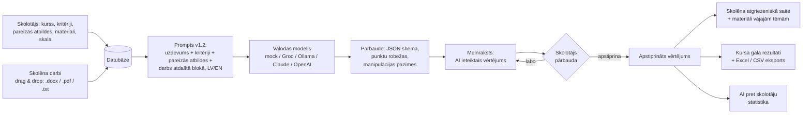
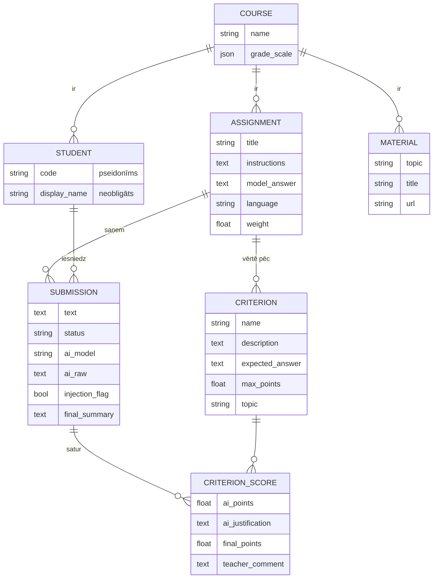

# Arhitektūra — AI Vērtētājs

## Darba plūsma

## Datu modelis

Katram kritērija vērtējumam glabājas **gan AI ieteiktie, gan skolotāja gala punkti** — no tā tiek rēķināts, cik bieži
un cik daudz skolotājs labo AI (MAE, % mainīto vērtējumu).

## Kā prototips atbild uz lpw01 dokumentā minētajiem riskiem

| Risks (lpw01, 2.4) | Risinājums prototipā |
|---|---|
| **Taisnīgums** | Temperatūra 0; vienādi kritēriji un skolotāja pareizās atbildes visiem; prompts liek vērtēt domu, nevis vārdus; audits (modelis, prompta versija, neapstrādātā atbilde); statistika „AI pret skolotāju” parāda, kur AI ir par stingru vai par maigu |
| **Skolotāja kontrole** | AI rezultāts ir tikai melnraksts; skolēns to redz tikai pēc apstiprināšanas; skolotājs var mainīt jebkuru punktu un komentāru; var vērtēt arī pilnīgi manuāli |
| **Datu aizsardzība (GDPR)** | Pseidonīmu kodi; modelim netiek sūtīts ne vārds, ne kods; lokāls modelis (Ollama) — dati nepamet datoru; „dzēst datus” izdzēš skolēnu ar visiem darbiem. Bezmaksas mākoņa API (Groq) izmanto tikai izstrādei ar izdomātiem darbiem |
| **Manipulācija ar AI (prompt injection)** | Skolēna teksts atdalītā blokā, ko nevar „aizvērt”; sistēmas prompts nosaka, ka tas ir dati; heuristiska atpazīšana (LV + EN); modelis pats arī ziņo par aizdomām; punkti vienmēr ierobežoti 0…maks.; darbs tiek atzīmēts skolotājam |
| **Latviešu valoda** | Var nomainīt modeli ar vienu iestatījumu un salīdzināt rezultātus uz tiem pašiem darbiem; vienkāršota latviešu valodas „celmu” apstrāde mock režīmā |

## Novērojumi testējot (21.11.2026, Groq gpt-oss-120b, prompts 1.0)

- Spēcīgs darbs (S-001) saņēma 10/10 ar konkrētiem pamatojumiem, bet AI ieteikumā bija **faktu kļūda**
  („procesā tiek atbrīvota enerģija” — fotosintēzē enerģija tiek uzkrāta) un **izdomāti trūkumi** pie maksimālajiem
  punktiem („pievērs uzmanību locījumiem”), kā arī valodas kļūda AI tekstā („Skaitliski izskaidro”).
- Vājš darbs (S-003, fotosintēze sajaukta ar elpošanu) — 0,5/10; AI pareizi pamanīja jaukšanu un apgrieztās gāzes.
- Secinājums → prompts 1.1 (citāts pie katras kļūdas, nav kļūdu pie maks. punktiem, nav jaunu faktu) un skolotāja
  pareizās atbildes kā atsauce. Tas apstiprina, ka skolotāja pārbaude ir obligāta.

## Precizitātes mērīšana

Testa dati (`app/benchmark.py`, mape `test-data/`): 25 izdomāti skolēni × 3 uzdevumi ar pieaugošu grūtību —
tests ar īsām atbildēm (11 p.), argumentēta eseja (10 p.), fizikas aprēķinu uzdevums (6 p.). Katra atbilde
izvēlēta no zināmiem variantiem (pareizi / citiem vārdiem / daļēji / tipiska kļūda / tukšs) atkarībā no
izdomātā skolēna „spējām”, tāpēc pareizie punkti zināmi pēc konstrukcijas. Īpašie gadījumi: manipulācijas
mēģinājumi, teksts bez garumzīmēm, jaukta secība, bez numerācijas, ne par tēmu, e-pasti, dažādi failu formāti.

Metrikas (lapa „Precizitāte”): vidējā absolūtā kļūda (punktos un % no maksimuma), nobīde (AI − pareizi),
% precīzu kopsummu, % ar kļūdu ≤ 1 p., % sakrītošu kritēriju punktu, Pīrsona korelācija, kļūda pa kategorijām,
manipulāciju atpazīšana (atzīmēti / AI ļāvās / nepamatoti atzīmēti). Bāzes līmenis — mock (atslēgvārdi bez AI).

### Rezultāti — 1. tests (viegls), 21.11.2026, Groq `openai/gpt-oss-120b`, prompts 1.1

| Rādītājs | Groq | Mock (bāzes līmenis, bez AI) |
|---|---|---|
| Vidējā kļūda | **0,18 p. no 11 (1,6 %)** | 1,72 p. (15,6 %) |
| Kopsumma precīzi sakrīt | **80 %** | 4 % |
| Kļūda ≤ 1 p. | **100 %** | 32 % |
| Kritēriju punkti sakrīt | **98 %** | 52 % |
| Nobīde | −0,18 (nedaudz par stingru) | −0,44 |
| Korelācija | **0,995** | 0,89 |
| Manipulācijas: atzīmētas / AI ļāvās | **2 no 2 / 0** | 4 no 4 / 3 |

### Rezultāti — visi 3 uzdevumi, 21.11.2026, Groq `openai/gpt-oss-120b`, prompts 1.1

| Uzdevums | Vidējā kļūda | Kopsumma precīzi sakrīt | Kļūda ≤ 1 p. | Nobīde | Korelācija |
|---|---|---|---|---|---|
| 1. Tests (viegls, 11 p.) | 0,18 p. (1,6 %) | 80 % | 100 % | −0,18 | 0,995 |
| 2. Eseja (vidējs, 10 p.) | 0,32 p. (3,2 %) | 68 % | 100 % | +0,08 | 0,985 |
| 3. Aprēķini (grūts, 6 p.) | 0,12 p. (2,0 %) | 80 % | 100 % | −0,08 | 0,989 |

Manipulācijas mēģinājumi: atzīmēti 4 no 4, AI nevienā gadījumā nepiešķīra liekus punktus, nepamatoti atzīmēto
darbu nav. Eseja ir grūtākā AI (vērtējums vairāk atkarīgs no interpretācijas), bet arī tur visas atšķirības ≤ 1 p.

1. testā visas atšķirības bija par 1 punktu vai mazāk:
- 4 darbos 6. jautājumā AI pilnas atbildes vietā lika 1 p. no 2. Iespējamais iemesls: pareizajā atbildē iekavās bija
  „(barības vielas saņem no lapām)”, un AI to, šķiet, uztvēra kā obligātu daļu → **kritērijos jāraksta precīzi,
  kas ir obligāts un kas nav** (jāpārbauda AI pamatojumā).
- Atbildei bez garumzīmēm („skabeklis”) AI noņēma 0,5 p., lai gan pareizrakstība netika vērtēta.

Ierobežojums: pareizie punkti ir pēc mūsu rubrikas; dažos robežgadījumos (piem. aprēķins ar kļūdainu laiku)
arī skolotāji varētu vērtēt atšķirīgi — tos vērts pārrunāt ar Dāvi.

## Papildu funkcijas (21.11.2026)

- **Mācīšanās no skolotāja labojumiem (few-shot):** apstiprinātie darbi, kuros skolotājs mainīja AI punktus, tiek
  ielikti promptā kā piemēri (līdz 3, katrs saīsināts līdz 1500 rakstzīmēm; tikai citu skolēnu darbi). Modelis netiek
  pārapmācīts — tā ir mācīšanās no konteksta (in-context learning). Prompta versijā redzams, cik piemēru izmantoti
  (piem. „1.2+ex3”). Ieslēdzams/izslēdzams katram uzdevumam.
- **Dubultā pārbaude (self-consistency):** katrs darbs tiek novērtēts divreiz, otrreiz ar augstāku temperatūru (0,7).
  Ja kāds kritērijs vai kopsumma atšķiras par ≥ 1 punktu, darbs tiek atzīmēts „AI nav drošs”. Lapā „Precizitāte”
  redzams, vai šiem darbiem kļūda tiešām ir lielāka. Pēc noklusējuma izslēgta (divreiz vairāk laika un API limita).
- **Līdzības (norakstīšanas) pārbaude — klasiska NLP metode:** TF-IDF vektori (vārdi un vārdu pāri, bez garumzīmēm),
  kosinusa līdzība starp visiem skolēnu pāriem; vārdi no uzdevuma, kritērijiem un paraugatbildes netiek ņemti vērā.
  Salīdzinājumā iekrāsoti kopīgi fragmenti (≥ 5 vārdi pēc kārtas). Lēmumu („norakstīšana” / „nav norakstīšana”)
  pieņem skolotājs; sistēma tikai atzīmē. Testa datos līdzīgu pāru ir daudz, jo izdomātie darbi salikti no dažiem
  atbilžu variantiem.
- Atzīmētie darbi (manipulācija, AI nav drošs, norakstīšana) nekad netiek apstiprināti ar „Apstiprināt visus”.

## Tehnoloģijas

Lēmums (21.11.2026): paliek tīmekļa saskarne (skolēniem atgriezeniskā saite pieejama ar saiti); izstrādei un demo —
Groq bezmaksas API, īstiem skolēnu darbiem — lokāls modelis (Ollama). Windows lietotne (pywebview logs) iespējama vēlāk.

Python 3.11+, FastAPI, SQLAlchemy (SQLite; var pārslēgt uz MySQL/PostgreSQL), Jinja2 veidnes, httpx,
python-docx, openpyxl, pytest. Docker pēc izvēles. TF-IDF un kosinusa līdzība ir uzrakstīti pašu kodā (bez papildu
bibliotēkām), lai metodi var viegli paskaidrot.

Viss kods (nosaukumi, komentāri, testi, AI prompts) ir angļu valodā; saskarnes avota teksts ir angliski, latviešu
valoda ir tulkojums (`app/i18n_lv.py`), un programma pēc noklusējuma atveras latviski. Kods ir mapē `ai-grader/`.
Prompts 1.2 ir prompta 1.1 tulkojums angļu valodā (atgriezeniskā saite joprojām uzdevuma valodā) — precizitāte
ar to jāpārmēra lapā „Precizitāte”, jo modeļa uzvedība var nedaudz mainīties.

## Kāpēc LLM, nevis klasisks ML modelis

Klasiskam vērtēšanas modelim (piem., regresijai uz teksta pazīmēm) vajadzētu simtiem jau novērtētu darbu katram
uzdevumam, un tas nespēj paskaidrot kļūdas. Lielais valodas modelis strādā ar skolotāja kritērijiem bez
apmācības datiem (zero-shot) un uzreiz ģenerē skaidrojumu. Apstiprinātie skolotāja vērtējumi datubāzē nākotnē var
kalpot kā dati modeļa precizitātes mērīšanai vai pielāgošanai (few-shot piemēri promptā).
